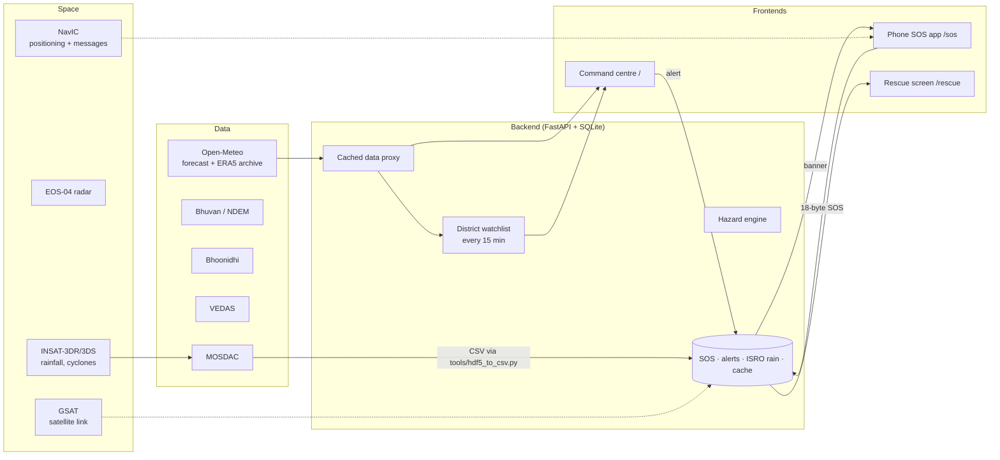

# ResQLink — Predict from space · Connect when networks fail

**Team Squad Zero · ASTRA 2026 (ANTERiX Club, VIT Bhopal) · Domains 3 + 4**

ResQLink connects two problems:

1. **Domain 3, disaster prediction:** it uses satellite and weather data to warn a district before a flood, cyclone or landslide hits.
2. **Domain 4, communication when networks fail:** when mobile towers go down, it gets the alert out and gets SOS messages back in using NavIC positioning, a LoRa radio mesh and a satellite link.


---

## 1. Run it (3 ways)

> **Online with a public link (free, ~20 min):** see [DEPLOY.md](DEPLOY.md) (Render; Dockerfile and Procfile included).

| Way | When to use | How |
|---|---|---|
| **A. Full system** (recommended for judging) | Laptop + phones on the same wifi | Windows: double-click **`start.bat`**. Mac/Linux: `./start.sh`. Then open **http://localhost:8000** |
| **B. Standalone** | No Python, or as a backup | Double-click **`standalone/ResQLink.html`** and it opens in Chrome |
| **C. Offline with photos** | Venue has no internet | In A or B, with internet: Recon panel → **📥 Download photos**. This saves `ResQLink-offline.html` with every photo built in |

Requirements for A: **Python 3.10+**. `start.bat` installs `fastapi`, `uvicorn`, `httpx` and `python-multipart` for you.
Phones: scan the **QR code** on the command centre (same wifi). On Windows, allow Python through the firewall when it asks.

---

## 2. What happens in a demo (one search runs it all)

```
🌍 Target lock → ☁️ Present weather → 📈 Past data → prediction → ⚠️ Hazard risk → 📶 NavIC alert → 🆘 Offline SOS → 🚁 Rescue
```

| Phase | What you see | How it works |
|---|---|---|
| **Target lock** | A 3D Earth turns to the place; a pin, an INSAT-3DR link arc and photos appear | **World search box:** suggestions appear as you type from the 10 disaster cases, cities and towns (Open-Meteo) and villages, landmarks and addresses (OpenStreetMap). Use the arrow keys and Enter, ✕ to clear, or type `lat, lon`. Clicking the box selects the old text so you can type straight over it. You can also click the globe or the 2D map |
| **01 Present weather** | Temperature, humidity, gusts, 72 h rain, past 72 h rain, elevation, river flow | Forecast + flood + elevation APIs (cached by the backend) |
| **📊 Scorecard** | One click backtests all 10 past disasters: the alert level 3, 2 and 1 day before each, lead time, and observed vs predicted rain | Same model and engine as the live run. Needs internet once, or data cached by the backend. Copy the result straight into slides |
| **02 Past data → prediction** | Chart of the last 14 days, then a 3-day forecast with **actual rainfall shown next to it** | **Analog-ensemble model**, explained below. Uses 20+ years of daily data. Past-disaster cases start from the day before the disaster |
| **03 Hazard risk** | RED/ORANGE/YELLOW/GREEN alert with a 0–100 score for 5 hazards and the reason | Rule engine using IMD rainfall classes (64.5/115.6/204.4 mm/day) and wind categories, plus slope and river flow |
| **03 Impact** | **Villages and people in the 12 km zone** (and within 2.5 and 6 km), plus a **numbered evacuation order** on the map | Every PMGSY habitation in the zone, ranked by population × closeness. Wayanad test: 119 places, 57,619 people; first to evacuate: Puthumala, Muttur, Chooralmala |
| **04 NavIC alert** | The alert in **English + Hindi + the state's language** (Malayalam, Tamil, Telugu, Kannada, Marathi, Gujarati, Bengali, Odia or Punjabi), with a 🔊 **read-aloud** button and a **160-character SMS version** for feature phones | Pushed to every phone running the SOS app. Phones show it in their chosen language and vibrate |
| **05 Offline SOS** | Towers "go down"; 26 SOS signals hop through a LoRa relay mesh to a satellite gateway | Shortest-path routing (3.6 km radio range), **18-byte packet with a checksum**, decoded and checked on the server |
| **Rescue** | A priority queue, teams assigned with arrival times, and a rescue-team screen | Server-side assignment: highest priority first, nearest team first |

**Feature phones:** SMS `SOS M 4 5` (Medical, 4 people, severity 5) goes to the simulated SMS gateway. The location comes from the cell tower, the SOS appears on the map as 📟, and the sender gets an SMS reply.

**Phone SOS (the live moment):** a judge scans the QR → hold the **SOS** button for 1.5 s → a 📱 appears on the command map within 2 s → the rescue screen marks it ✅ → the judge's phone shows "🎉 Marked rescued".

---

## 2a. 🎬 Present mode (for judges)

Click **🎬 Present** at the top right, or use **→ / Space** to advance, **←** to go back, **Esc** to exit. Twelve steps drive the live app with a caption bar and highlight each panel in turn:

problem → target lock (globe fly-in to Mundakkai) → **disaster history dossier** → present weather → past-data prediction → hazard + people at risk → alert in Malayalam/Hindi → broadcast to phones → network collapse + offline SOS → rescue dispatch → scorecard → thank you.

Each step waits until the app has finished, so you can talk at your own pace. Phones that scanned the QR code receive the alert live during step 7.

## 2b. Place dossier: the full record for any place

Every search (or map click) builds a **dossier**:

| Section | Source | Offline? |
|---|---|---|
| Floods recorded in the district since 1967, **last flood** (date, cause, deaths, displaced, damage), floods per decade | **India Flood Inventory v3**: 6,876 events 1967–2023, compiled by IIT Delhi HydroSense Lab with IMD (CC BY-NC 4.0), matched by district (1.04M habitations + a 0.1° district grid) | ✅ |
| Landslides recorded | India Flood Inventory (landslide / mud-slip events) + optional **NASA Global Landslide Catalog** import | ✅ |
| Cyclones that passed within 150 km (name, date, closest distance, peak wind) | Optional **NOAA IBTrACS** import | ✅ after import |
| Earthquakes M4.5+ within 300 km | **USGS** earthquake catalogue (live) | cached by backend |
| Recent satellite-observed events (storms, floods, fires, volcanoes) | **NASA EONET** (live) | cached by backend |
| Climate record: average rain per year, wettest month, **wettest day on record**, hottest day | 20+ years of daily data used by the prediction model | needs data once |
| "Inside hazard zone: …" | Any **Bhuvan / NDEM layer** you import (GeoJSON, KML or zipped shapefile) | ✅ (saved on the server) |

Example (Mundakkai): Wayanad district, 138 flood events since 1968, last recorded flood on 23 Jul 2023, 11 landslide or mud-slip events. The inventory ends in 2023, so it doesn't include the July 2024 landslide.

### Data you can download and add (optional)

| Data | Where to get it | How to add |
|---|---|---|
| **Cyclone tracks** | NOAA IBTrACS → CSV → `ibtracs.NI.list.v04r01.csv` (North Indian basin) | Put it in `backend/data/` (it loads on start), or use **📥 Import disaster data** in the dossier |
| **Landslides** | NASA Global Landslide Catalog CSV from data.nasa.gov (or the COOLR export from landslides.nasa.gov) | Same: file name containing `landslide` or `glc`, or import |
| **Earthquakes (offline copy)** | USGS earthquake search → CSV | Same: file name containing `earthquake` or `usgs`, or import |
| **Bhuvan / NDEM hazard zones** | Bhuvan thematic downloads or NDEM layers exported to GeoJSON/KML/shapefile (e.g. the Assam flood-hazard layer `ndem50d:asfhz50dsc1998_2023` with the `wmsdump` tool, then QGIS → GeoJSON) | **🗺 Import hazard layer**: it's drawn on the map, saved on the server, and the dossier says if the place is inside a zone |
| **MOSDAC INSAT-3DR rainfall** | MOSDAC → INSAT-3DR rainfall HDF5 → `tools/hdf5_to_csv.py` | Phase 02 → **Upload CSV**: it replaces the reanalysis rain for that area |
| **Any other events** | Any CSV with date + latitude + longitude columns | **📥 Import disaster data** |

## 2c. Every place on Earth, and every village in India

| Where | Places | Works offline |
|---|---|---|
| Backend database | **1,041,694 Indian rural habitations** (villages and remote hamlets, with block, district, state and population; PMGSY, Govt. of India) **+ 135,233 world towns and cities** (GeoNames) | ✅ instant search (~0.2 s), nearest-place names |
| Built into the standalone file | 24,323 largest world towns and cities + **39,823 largest Indian villages** (population ≥3,000) | ✅ |
| Online | Open-Meteo city search + OpenStreetMap (villages, landmarks, addresses) | needs internet |
| Weather, past data, hazard scoring | **Any latitude/longitude on Earth** | simulated scenario when offline |

- Search a hamlet by name ("Tavada Palle", 474 people) or by name + district ("krishnapuram vellore").
- Clicking the map names the nearest habitation, e.g. "Chooramala, Kalpetta, Wayanad, Kerala".
- **First start:** the backend builds its places database once, which takes about 10–30 s. Search works as soon as the log says "Server database: 1,041,694 Indian villages…".

## 2d. Works at the venue without internet

| Need | Full project | Standalone file |
|---|---|---|
| Map | **🗺 Cache maps on server** saves ~2,000 satellite tiles for all 10 disaster sites and the current area | **📥 Download photos + maps** saves ~60 tiles per disaster site inside `ResQLink-offline.html` |
| Places | 1.18 M places in SQLite | 24k towns + 39,823 large villages built in |
| Weather and past data | Cached after first use (forecast 15 min, archive 30 days) | Simulated scenarios, clearly labelled |
| ISRO layers | Map layer menu (top right): NDEM Assam flood hazard, Bhuvan land use. Online only; their availability depends on NRSC servers | same |

## 2e. Interface: everything in one click

| Where | What |
|---|---|
| **Mission brief** (on the globe at start) | ▶ Wayanad landslide 2024 · 🌀 Cyclone demo (offline) · 🔍 Search · 🎬 Present |
| **8 tabs** (right panel) | Brief · Recon · Weather · Predict · Risk · Alert · SOS · ISRO. An orange dot means new data in that tab. The flow switches tabs for you |
| **Quick bar** (bottom of map) | Scan · Globe · What-if · Bhuvan · Alert · Collapse · Rescue · Present · Help |
| **Live alert banner** | Top of the map; click it to open the risk tab |
| **What-if simulator** (Risk tab) | Sliders for rain, past rain, wind and heat, plus presets (Cloudburst, Cyclone landfall, Heatwave, Monsoon week). Shows now vs what-if; "Apply" re-issues and broadcasts the alert |
| **Bhuvan live layer** | 🛰 button or `L`: ISRO Bhuvan flood layer (WMS, needs internet). More ISRO layers under the ⧉ map icon |

**Keys:** `/` search · `1–8` tabs · `W` what-if · `B` broadcast · `C` collapse network · `R` rescue · `G` globe · `L` Bhuvan · `P` present · `?` help · `Esc` close.

## 2f. Weather / Predict not loading? (network check)

The **🌐 chip** in the header shows what works: `LIVE DATA` (server online), `LIVE · DIRECT` (server blocked, Chrome works), `OFFLINE · SAVED` or `OFFLINE`. Click it for a full check with the fix.

How the app adapts by itself:
1. **Server route** (cached in SQLite) → if blocked, 2. **direct from Chrome** (college Wi-Fi often blocks Python but not Chrome) → if no internet, 3. **saved copy** in this browser (last 40 responses) → else a clearly labelled SIMULATED scenario.

| Problem | Fix |
|---|---|
| `LIVE · DIRECT` | Already working. To fix the server too: `set RESQ_PROXY=http://PROXY:PORT` then `start.bat` (proxy from Windows Settings → Network → Proxy). `pip install truststore` fixes networks that inspect HTTPS (start.bat installs it) |
| `OFFLINE` | Phone hotspot → click ↻ Check again. If Wi-Fi has a login page, log in through Chrome first |
| Venue Wi-Fi unreliable | Scan your demo places once at home: they are saved in the browser and on the server, so they work offline |
| `/api/netcheck` | Server-side check of each data source (weather, past data, search, map) |

## 2g. Live maps + hyperlocal weather (real-time)

Press **M** or **🗺 LIVE MAPS** on the map.

| Layer | Source (free, no key) | Updates |
|---|---|---|
| 🌧 Rain radar (animated, past 2 h) | RainViewer | every 5 min |
| 🛰 Satellite rainfall | NASA GIBS · IMERG (GPM) | 30 min |
| ☁️ Clouds infrared | NASA GIBS · Himawari-9 | 10 min |
| 📷 Today's satellite photo | NASA GIBS · MODIS Terra | daily |
| 🌊 Flood water (3-day) | NASA GIBS · MODIS flood | daily |
| 🔥 Active fires | NASA GIBS · MODIS thermal anomalies | daily |
| ⚡ Earthquakes 24 h | USGS live feed | 10 min |
| ⚠️ Live disasters worldwide | NASA EONET | 10 min |
| 🇮🇳 Bhuvan / NDEM layers | ISRO (often slow) | — |
| Base maps | Esri satellite · OSM · OpenTopoMap terrain · HOT humanitarian · CARTO dark | — |

Each layer shows **● live** or **✕ not answering**, so you know at once if a server is down.

**Hyperlocal weather** (Weather tab): conditions now (rain/cloud/feels-like), plus a **15-minute rain nowcast for the next 3 hours** ("Rain starts in ~45 min"). It uses Open-Meteo's nearest grid cell and auto-refreshes every 10 min.

## 2h. 🇮🇳 All-India live risk (every district)

**🇮🇳 INDIA** button (or `I`, or "All-India risk now" on the start screen) scores **all 691 districts** with the same hazard engine: rain for the past 3 days and the next 3, wind, heat, humidity, and local relief for landslides. Results appear as a coloured dot map, RED/ORANGE/YELLOW/GREEN counts and the top 15 districts (click one for the full analysis). It updates every 3 h and pops up when a new district turns ORANGE/RED. District points come from PMGSY habitations (population-weighted) plus major cities.

**Live map layers through the server:** if the browser can't load NASA / RainViewer / ISRO tiles, the map automatically retries them through `/api/xtile/…` on our server and shows "● live (via server)".

## 2i. Google Weather API + Simple mode + 3D India

**Google Weather (optional, real-time):** click the **GOOGLE: OFF** chip in the header and follow the 5 steps (Google Cloud project → link billing → enable *Weather API* → create API key → paste → *Save & test*). Or start the server with `set GOOGLE_WEATHER_KEY=AIza…`. When connected, Google's current conditions (refreshed every 15 min) and 72-hour hourly forecast replace the model values; Open-Meteo still supplies soil moisture, rivers, the 15-minute rain nowcast and 20+ years of history. The key stays on the server (`/api/google/*`) and is never sent back to browsers. Without a key everything works on Open-Meteo.

**😀 Simple / 🧑‍💻 Expert switch** (header). Simple mode is one card in plain words: a risk gauge, "Act now / Get ready / Be aware / Safe", **why** in simple sentences, weather right now, what people should do, 4 one-tap actions (Warn everyone · Phone towers fail · Send rescue · What if more rain?) and "How do we know?". Expert mode has all 8 tabs. Present mode switches to Expert automatically.

**🇮🇳 All India in 3D:** every district becomes a 3D column on the globe. Height and colour show risk; hover for the district list, click a column to open it. "Flat map" switches to the 2D dot map.

## 3. Architecture



### Folder structure
```
resqlink/
├── start.bat / start.sh         one-click start
├── backend/
│   ├── app.py                   FastAPI: data proxy + cache, SOS, alerts, dispatch, ISRO upload, watchlist, serves the frontends
│   ├── hazard.py                hazard engine (same results as the browser engine, checked by a test)
│   ├── packet.py                18-byte LoRa SOS packet encode/decode + checksum
│   ├── history.py               disaster history dossier (flood inventory, cyclone tracks, landslide/earthquake/event imports)
│   ├── data/india_flood_inventory_v3.csv.gz  6,876 IMD-sourced flood events 1967–2023 (IIT Delhi HydroSense, CC BY-NC 4.0)
│   ├── data/world_places.tsv.gz 135,233 towns and cities worldwide (GeoNames, population ≥1000)
│   ├── data/india_habitations.tsv.gz 1,041,694 Indian rural habitations (PMGSY), loaded into SQLite on first start
│   └── tests/                   pytest: API, packet, cache, browser↔server engine match
├── frontend/
│   ├── index.html               command centre (globe, map, phases, live demo panel, watchlist)
│   ├── sos.html                 phone SOS app
│   ├── rescue.html              rescue-team screen
│   └── vendor/                  Leaflet, Globe.gl (Three.js), Chart.js, QR code library, Earth image (works offline)
├── standalone/ResQLink.html     command centre as one file (no server needed)
├── tools/build_standalone.py    rebuilds the standalone file after you edit frontend/index.html
├── tools/hdf5_to_csv.py         MOSDAC INSAT rainfall HDF5 → daily CSV
├── tools/build_india_villages.py rebuilds the India village files from the PMGSY open data
└── docs/                        PITCH.md, screenshots
```

---

## 4. The models (how to explain them to judges)

**Prediction from past data (analog ensemble).**
- For the cutoff date, the model takes the last 7 days of rain.
- It searches all past years (same season ±45 days) for the **20 most similar 7-day periods**. Recent days count more in the comparison.
- What happened in the 3 days after each of those periods is the forecast ensemble. The app shows the average, the 90th percentile and the chance of heavy and very heavy rain.
- The hazard engine uses the **75th percentile**, which leans towards warning early.

The model is easy to explain, works anywhere on Earth with data from 1940 onward, and shows the actual rainfall next to the prediction.

**Hazard engine.**
- **Flood:** biggest rain day, rain in the days before, river flow vs normal, flat or low ground, soil moisture.
- **Cyclone/Wind:** peak gust (gale ≥62, storm ≥88, severe ≥118 km/h).
- **Landslide:** how steep the ground is within 1.5 km × 6-day rain.
- **Heatwave:** max temperature (≥40 °C in the plains).
- **Forest fire:** dry spell × max temperature × low humidity.

The same engine runs in the browser (`frontend/index.html`) and on the server (`backend/hazard.py`). `test_parity.py` checks 300 random cases and confirms both give the same scores.

**Rescue priority** = severity×12 + people×5 + area risk×0.3 + low battery×0.15 + 15 if medical.

---

## 5. API (backend)

| Method | Path | Purpose |
|---|---|---|
| GET | `/api/health`, `/api/info` | Status; LAN address and QR links |
| GET | `/api/om?u=<url>` | Cached proxy for allow-listed hosts (Open-Meteo, Nominatim). Serves the last saved copy if the internet drops |
| POST/GET | `/api/state` | Current incident (place, alert level, hazard, score) |
| POST | `/api/sos` | `{hex}` 18-byte packet (checksum checked) or plain fields. Returns the priority |
| GET / PATCH / DELETE | `/api/sos`, `/api/sos/{id}` | Queue, status (`open/assigned/enroute/rescued`), reset |
| POST | `/api/dispatch` | Assign teams (priority first, nearest team) and calculate arrival times |
| POST / GET | `/api/alerts`, `/api/alerts/latest` | Alert broadcast that phones receive |
| POST / GET | `/api/isro/upload`, `/api/isro/rain` | Store ISRO/IMD rainfall CSV; it replaces the archive rain for that area |
| GET | `/api/impact?lat&lon&radius_km` | Villages and people in the zone, rings, and the ranked evacuation list |
| POST | `/api/sms` | Simulated SMS gateway: `SOS <T/M/S/X> <people> <1-5> [lat,lon]` → SOS + reply text |
| GET / POST | `/api/tile/{z}/{y}/{x}`, `/api/tiles/prefetch` | Cached satellite map tiles + background download for offline use |
| GET | `/api/history?lat&lon` | Place dossier: district floods, last flood, landslides, cyclones, imported events |
| POST | `/api/history/import` | Import IBTrACS / landslide / earthquake / any event CSV (kept across restarts) |
| GET / POST / DELETE | `/api/layers` | Hazard-zone layers (GeoJSON) for the map and the dossier |
| GET | `/api/watch` | 12 districts scored on the server (refreshes every 15 min) |
| GET | `/api/places?q=`, `/api/places/near?lat&lon`, `/api/places/count` | **1.18 million places** (every Indian rural habitation + world towns): offline search (name, or name + district) and naming the nearest place for any point |

Interactive docs: **http://localhost:8000/docs**

---

## 6. Using real ISRO data

1. **MOSDAC** (mosdac.gov.in): sign up, then Catalog → INSAT-3DR → rainfall product (e.g. `3RIMG_L2B_IMC`, IMSRA, half-hourly). Download the HDF5 files.
2. Run `python tools/hdf5_to_csv.py --inspect FILE.h5` to find the variable names, then convert them for your place (the instructions are at the top of the script).
3. In the command centre: Phase 02 → **Upload CSV**. With the backend running, the rows are stored and used automatically: the past-data model **uses your ISRO rainfall in place of the archive rainfall** for matching days. The screen then shows "🛰 Rainfall from … used for N days".
4. **Bhuvan / NDEM:** flood hazard zones and landslide maps are published as WMS map layers. These are the next layers to add to the map.
5. **Bhoonidhi:** EOS-04 radar images to check flooding after an event.
6. **VEDAS:** soil wetness index for the soil-moisture factor.

---

## 7. Testing

```
python -m pytest -q backend/tests        # 16 tests: history dossier, imports, layers, API, packet checksum, cache, watch list, places, impact, SMS, alert languages, tiles, browser↔server engine match
```
Checked before release (headless Chrome):
- full backend run: command centre → alert reaches the phone → phone SOS → 26 simulated SOS → dispatch → rescue screen → phone shows "rescued"
- standalone file online and fully offline
- the 📥 photo download in both modes
- map-click re-target

Result: no page errors and no failed API calls.

## 8. Honest limitations (say these before judges ask)

- **Live data:** the prototype uses Open-Meteo for live and archive weather. ISRO data comes in through the CSV upload path. A direct MOSDAC API connection needs an account and is the next step.
- **Gridded data underestimates local extremes:** ERA5 data is averaged over ~10–25 km squares. The past-data model is good at spotting "dangerous build-up + slope", but it predicts less rain than actually falls on extreme days. That's why the alert also uses the rain already observed in the days before.
- **Simulated radio network:** the LoRa mesh and satellite link are simulated. The packet format, checksum, routing, priority and dispatch logic are real code. On phones, the SOS reaches the server over wifi.
- **Translations:** the alert sentences in 9 Indian languages were written by AI, so a native speaker should check each one before real use. Read-aloud uses the voices installed in the browser or phone.
- **Disaster history:** the flood inventory is matched by district name, and its events may cover several districts, so a district's count includes state-wide events that touched it. It ends in 2023.
- **Impact numbers** use PMGSY's recorded population (older census-based figures), so treat them as an estimate.
- **GPS on the phone app:** browser GPS needs https. On a local `http://` address the SOS app uses a demo position inside the incident zone and says so on screen.

## 9. Credits

Map and globe libraries: Leaflet (BSD-2), Globe.gl/Three.js (MIT), Chart.js (MIT), qrcode-generator (MIT). Earth image: NASA Blue Marble via three-globe.
Disaster history: India Flood Inventory v3 (Saharia et al., IIT Delhi HydroSense Lab with IMD; CC BY-NC 4.0); USGS earthquake catalogue; NASA EONET. Places: GeoNames (CC BY 4.0) via the all-the-cities package; Indian habitations from PMGSY / Ministry of Rural Development (geosadak-pmgsy.nic.in, Government Open Data License – India), packaged by ramSeraph/indian_admin_boundaries. Data: Open-Meteo (CC BY 4.0; ERA5 from Copernicus/ECMWF, GloFAS), OpenStreetMap Nominatim, Wikipedia/Wikimedia Commons (each photo links to its author and licence), Esri World Imagery.
